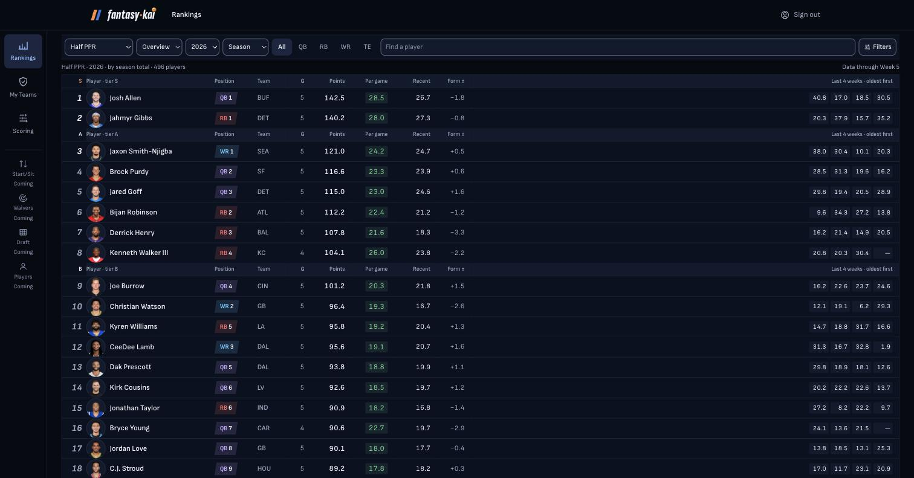

# Dense member rankings and league availability — review, 2026-11-02

Branch `codex/dense-rankings-2026-11-02`, created in a fresh worktree from main `72fbe50`.
This is separate from the S2/S3 PR so the layout can remain draft until visual acceptance.
No new dependency. No change to the public landing's source or rendering components.

## Findings

1. **P1 release gate, partially open:** Claude checked `c3e5cd1`, with results supplied by the
   owner: **1710×951**, first player row **181px**, player rows **38px**, **19 complete rows**,
   tier-only bands **16px**, and **no horizontal page overflow**. Sticky labels were at **57px**,
   with **0px alignment error on all 10 measured columns**. The wide-screen layout is accepted.
   These are supplied browser measurements, not Codex measurements or proof at 1440×900.
   **1440×900, 1024 and 390 remain unmeasured.** Keep the PR draft until narrow widths are
   checked or explicitly waived by the owner; no waiver has been given.
2. **P1 deploy-order risk, fixed in code:** the running production jar lacks `BoardController`.
   Switching exclusively to `/rankings/board` would turn working rankings into an error before
   the API deploy. Only a 404 falls back to the existing `/rankings` points response. Additional
   metrics stay explicitly null, shown as dashes, with “Extended stats coming shortly”. A missing
   private profile remains 404 on the legacy route too. Auth, rate-limit, network and server errors
   are not reclassified. New tests preserve absent metrics, zeros and whole-population ranks.
3. **P2, fixed:** My Teams classified a missing collection route as an error. Only that collection's
   404 now reads “League import is coming to your account shortly” without a retry, and disables
   the unavailable discovery form. Other errors retain the existing alert and retry.
4. **P2, fixed in code after Claude QA:** the weekly detail cell absorbed all extra table width,
   leaving a wide blank band after Form. Usage squeezed three values into that same cell.
   `BoardColumns.tsx` now supplies a fixed table grid shared by body and header: 40px rank,
   240px player, 200px weekly details, 64px movement when present; other columns share the
   available width. Usage gets three separate numeric cells and labels, preserving zero/null.
5. **P2, fixed in code after Claude QA:** labels disappeared mid-tier. `RankingsBoard.tsx` now
   renders a compact sticky label band below the 56px top bar plus its 1px border. It sits outside
   the horizontal scroller so that overflow containment cannot disable vertical stickiness.
   Its horizontal offset follows the body; both use the same colgroup. The visual duplicate is
   aria-hidden. Claude subsequently verified sticky placement and alignment on `cde743b` at
   1710×951 (below). The body table now has a hidden native thead for column associations.
6. **P2, fixed in code after the second Claude QA:** the sticky label row and tier bands repeated
   the column names. `TierHeader.tsx` now renders only a tier name in a 16px target separator,
   with `scope="rowgroup"` and the correct Overview/Usage/movement colspan. Column names are
   drawn once by `ColumnHeaders` in the sticky band and retained in a visually hidden native
   thead for assistive technology. Turning tiers off removes the separators entirely. Claude
   confirmed 16px tier-only bands and accessible labels on `c3e5cd1`; narrow widths remain open.

Reviewed every changed hunk for URL serialization, search debouncing, stale ranking movement,
player overlay links and saved scroll position; absence versus zero; mobile overflow; disabled
Coming items versus links; duplicate navigation; token storage, session restore and CSP changes;
shared landing dependencies; and text/background pairs. Auth code is untouched. No simulated
member session or hidden authentication bypass was used.

## Implemented contract

- 88px icon rail from lg, top bar/menu below lg; held Trades absent.
- One control strip: scoring, Overview/Usage, season, window, position, search, Filters.
  Native selects and a two-group phone arrangement; all options remain usable.
- 38px row target with 36px face, 16px tier-only separators, one sticky column-label band, tabular figures,
  internal horizontal table scroll with pinned rank. A closable Filters section controls tiers.
- Board API supplies positional/per-game ranks, recent points, form, last four weeks and usage.
  No snap percentage invented. View is URL state; a ruleset change retains movement and a
  collapsed biggest-moves disclosure. Existing intercepted player route and return logic remain.
- DESIGN.md records the 2026-11-02 owner decision. New contrast pairs were calculated using WCAG
  relative luminance and sRGB alpha compositing, and recorded in globals.css. The lowest new
  foreground pair is faint/Well at 4.99:1; green on its 10% tint is 8.37:1, 7.55:1 over hover Well.

## Gates — actual output

The appended transcript contains local output. `git diff --check` is clean. The public site,
landing components/data, RequireAccount, memberHint, csp and proxy paths have an empty diff
against main. `globals.css` adds only the contrast comment; shared landing quality tokens are unchanged.
An anonymous HTTP request to `http://localhost:3001/rankings` returned:

```text
HTTP/1.1 307 Temporary Redirect
location: /login?next=%2Frankings
```

This is an auth regression check, **not browser QA**. Backend verify is not repeated for this PR:
no Java, migration, dependency or backend configuration changes. The separate S2/S3 PR ran its
full clean verify, including the new empty-roster regression.

## Browser evidence and remaining acceptance

Claude's checks used the owner's already-signed-in local account, not a new QA account. No
account was created or deleted; do not delete that existing account. Changing scoring only
changed the URL. Scoring re-ranked points and showed movement plus biggest movers; position,
Filters and Usage worked; URL settings survived reload; the player overlay opened and Escape
returned to the same scroll position with filters retained. The production member request
returned 404 with the existing error message, confirming the deployment diagnosis.

The supplied screenshot is retained as **before the column/sticky-header follow-up**, not as
acceptance of the new code:



### Second Claude QA — cde743b, supplied by the owner

Claude rebuilt first: the 11:06 build preceded the 11:08 formatting edits in RankingsBoard and
PlayerRow. These observations apply to that rebuilt commit, **before removing repeated labels**:

| Check | Supplied result |
|---|---|
| Viewport | 1710×951 |
| First player row top | 189px |
| Player row height | 38px |
| Fully visible player rows | 18 |
| Horizontal page overflow | None |
| Wide spacing | Dead band gone; Claude reported eight stat columns at 155px each |
| Usage | Three separate columns |
| Sticky labels | Pinned at the top bar bottom, 57px |
| Header alignment | 0px offset on all 10 measured columns |

Claude found the sticky labels repeated in the first tier band, costing 25px. The revision now
removes column names from every tier band and uses shorter tier-only separators. Do not subtract
25px from the supplied first-row measurement and present that as a new observation; remaining
tier markers still occupy space. No new screenshot accompanied this second report. Chrome was
still full-screen and could not resize; **1440×900, 1024 and 390 are still unmeasured**.

### Accepted wide-screen QA — c3e5cd1, supplied by the owner

Claude checked `c3e5cd1` and reported that the 17:15 build was newer than the 16:33 source edits.
This timing is supplied QA context; Codex did not use timestamps to establish artifact contents.

| Check | Supplied result |
|---|---|
| Viewport | 1710×951 |
| First player row top | 181px |
| Player row height | 38px |
| Fully visible player rows | 19 |
| Tier bands | 16px, tier name only |
| Horizontal page overflow | None |
| Sticky labels | Pinned at the top bar bottom, 57px |
| Header alignment | 0px offset on all 10 measured columns |
| Accessible labels | Visible duplicate hidden from screen readers; native labels available |
| Decision | Wide-screen layout accepted; PR remains draft |

No new screenshot accompanied this report. **1024 and 390 remain unmeasured** because Chrome
was full-screen; **1440×900 also has no measurement**. Acceptance at 1710×951 is not recorded
as a waiver of the other widths. The owner requires the PR to remain draft until narrow QA
passes or they explicitly waive it. No such waiver, merge or deployment authorization was given.

Codex attempted to exit Chrome full screen through macOS window controls, but System Events
returned `osascript is not allowed assistive access (-25211)`. No window-state change was
confirmed. The owner can exit full screen with Control–Command–F so Claude can continue QA.

For the remaining QA, use an ordinary throwaway `@example.test` account created through **localhost:3000/register** on the refreshed follow-up preview;
keep its credentials private and delete the account after testing. Port 3000 serves the PR #80
build, restarted after rebuilding the follow-up. The API on 8080 is unchanged. Never seed
or bypass auth for visual acceptance.

| Check | Evidence required | Current result |
|---|---|---|
| 1710×951 signed in | Wide-screen layout and tier-label correction | Accepted on c3e5cd1; 181px / 38px / 19 rows, no overflow |
| 1440×900 signed in | First row top ≤220px, ≥16 complete visible rows, each ≤44px, page scrollWidth ≤ innerWidth | NOT RUN |
| 1024 wide | Rail, control wrapping, table scrolling, no page overflow | NOT RUN |
| 390 wide | At most two control rows; rank stays pinned during horizontal table scroll; compact menu | NOT RUN |
| Scoring and URL | Switch profiles, observe movement; settings survive reload | Claude passed before follow-up; regression check pending |
| Player | Open overlay after filter changes; close/back restores scroll and board; cold route works | Claude passed overlay/Escape/scroll restore before follow-up; cold route and revised layout pending |
| Filters | Open/close, keyboard focus, tier toggle, clear position/search | Claude passed position/Filters/Usage before follow-up; remaining details pending |
| Logged out | Landing screenshot unchanged, member route redirects | Source unchanged; HTTP redirect checked |
| My Teams | Actual missing API route shows coming shortly; other failure still shows retry | Classification unit test passed; browser pending |
| Production diagnosis | Signed-in GET /api/v1/leagues | Claude observed 404 and the existing error message; confirmed |
| Screenshots | Attach 1440/1024/390 images to this PR | Supplied 1710×895 before-fix image above; requested sizes pending |
| Cleanup | Delete only a newly created throwaway QA account | Claude used the owner’s existing account; no account to delete |

## Invariants and failure classes

No persistence, stats indexes, SQL, stat/signal registry, rounding engine, migration, ddl-auto or
external signal dependency changed. Member ranks are copied from API fields, not recomputed from
loaded pages. The legacy compatibility path preserves absence rather than presenting zero or an
invented rank. API ownership checks still precede response delivery. No transactional write,
ResultSet access, Redis client or backend bean changed. Tool failures were reported as failures;
no time-based freshness inference is used as production-image evidence.

## What I did not fix, and why

- No production deploy or merge: explicitly excluded by the owner's request. Deploy preparation
  and read-only VM evidence are in `docs/API-DEPLOY-2026-11-02.md`. Missing classes and V6 are
  confirmed; Claude subsequently observed the signed-in member HTTP 404 (owner-supplied evidence).
- No new Codex browser captures: Claude supplied accepted wide-screen measurements for c3e5cd1.
  The retained screenshot is from before the fixes; new responsive captures remain outstanding.
- No new projection view: the View menu switches real Overview/Usage cells already computed by
  the board endpoint. The projection job stays disabled; no unsupported prediction UI is implied.
- No local ingest or landing recapture: the owner required the logged-out landing unchanged. The
  local data freshness warnings are accurately retained.
- No commit of the four original untracked handoff/plan files; they remain in the league worktree.

## The argument against this change

The 1710×895 and 1710×951 results do not establish the 1440×900 acceptance target. This is not ready to merge
until the revised rendered board meets the requested measurements and the
phone controls and player-return flow have been exercised. The denser layout trades some touch
space and immediate scoring explanations for more visible players, and weekly columns require
horizontal scrolling on phones. The compatibility fallback adds one failed request per page
while the old API runs, and should be removed only after the production route is verified live.
A failure to fit 16 rows, an inaccessible mobile control, horizontal page overflow or a changed
logged-out landing is a reason to revise the implementation, regardless of passing builds.
Claude accepted the tier-only revision at 1710×951 with 19 rows and aligned labels on c3e5cd1.
That does not establish control wrapping, internal scrolling or header alignment at 1024/390,
or the original 1440×900 target. Keep the PR draft until narrow QA passes or the owner explicitly
waives it; a passing build does not establish those outcomes.

## Original gate transcript — 2026-11-02

`lint`

```text
> frontend@0.1.0 lint
> eslint
```

`test`

```text
✔ board display URL (0.757458ms)
ℹ tests 106
ℹ suites 34
ℹ pass 106
ℹ fail 0
ℹ cancelled 0
ℹ skipped 0
ℹ todo 0
ℹ duration_ms 142.9735
```

`build`

```text
> frontend@0.1.0 build
> next build

▲ Next.js 16.4.3 (Turbopack)
✓ Running next.config.ts took 14ms

  Creating an optimized production build ...
✓ Compiled successfully in 427ms
  Running TypeScript ...
  Finished TypeScript in 1006ms ...
  Collecting page data using 7 workers ...
  Generating static pages using 7 workers (0/9) ...
  Generating static pages using 7 workers (2/9)
  Generating static pages using 7 workers (4/9)
  Generating static pages using 7 workers (6/9)
✓ Generating static pages using 7 workers (9/9) in 156ms
  Finalizing page optimization ...

Route (app)
┌ ƒ /
├ ƒ /_not-found
├ ƒ /(.)players/[id]
├ ƒ /login
├ ƒ /players/[id]
├ ƒ /profiles
├ ƒ /rankings
├ ƒ /register
├ ƒ /teams
└ ƒ /teams/[id]


ƒ Proxy (Middleware)

ƒ  (Dynamic)  server-rendered on demand
```

`session`

```text
fantasy-kai — session check · 2026-11-02 12:11 CST

TOOLCHAIN
  ok    java        25.0.4.1 at ~/Library/Java/JavaVirtualMachines/jdk-25.0.4.1+1/Contents/Home
  ok    docker      postgres healthy · redis healthy (:5433, :6379)
  ok    node        v24.21.0 (.nvmrc wants 24.21.0)
  ok    env         .env present · JWT_SECRET 57 bytes

REPO
  warn  branch      codex/dense-rankings-2026-11-02, 21 uncommitted file(s)
  ok    sync        level with origin/codex/dense-rankings-2026-11-02
  warn  branches    merged into origin/main, safe to delete: feat/leagues-s0 feat/leagues-s1 feat/projections-backtest redesign/foundations redesign/landing redesign/player redesign/rankings
  ok    github      0 open PR(s) · last CI on main: success

SCHEMA
  ok    migrations  V1..V11 applied, all 11 checksums match the files on disk

DATA
  ok    rows        stats 117,820 · players 25,069 · games 1,965 (+3,341 since the docs)
  warn  ingest      local mirror last refreshed 2026-10-14 05:16, 19d 7h ago -- ./scripts/ingest-once.sh when you need current weeks
  warn  hero        landing hero shows 2026 through Week 6, but Week 7 finished 2026-10-26 -- the mirror is complete only through Week 5: ./scripts/ingest-once.sh, then re-capture it (docs/map.md §4)
  ok    launchd     not installed -- by design since 2026-09-29; production is the only scheduled ingest (DEPLOY health)
  ok    jar         source hash matches the jar (5462c2a33802)

DEPLOY
  ok    liveness    https://api.fantasykai.com is up
  ok    health      aggregate UP

CLAIMS  (a number here disagreeing with the baseline means the tree or the baseline moved)
  ok    tests       428
  ok    endpoints   24
  ok    backend     129
  ok    frontend    96
  ok    migrations  11

not checked here: does the suite pass · does the frontend build
  the gates for those are in CONTRIBUTING.md under "Review pass".

0 FAIL · 0 drift · 4 warn · 0 unknown
```


## Follow-up review and gates — 2026-11-03

Reviewed the complete follow-up diff, including the supplied screenshot. The landing only imports
`QUALITY_TEXT` from PlayerRow and that export is unchanged; the landing routes/components,
authentication, member hint, CSP and proxy have no diff from main. No new dependencies, colors,
metric computations, URL changes, account writes or backend changes. The invariant and failure-class
answers above still apply. In particular, each usage cell uses nullish fallback, preserving a real
zero, and no API rank is recomputed. The row links, movement, tier grouping, and player-return
handlers are unchanged. No Java verification was repeated locally for this presentation-only
follow-up; CI runs the backend suite. No new unit tests mirror the column classes; the existing
106 pure-logic tests still pass, while visual acceptance remains explicitly pending.

The first sandboxed session check could not reach Docker or the network (8 unknowns). The
unrestricted rerun below resolved that environment limitation: 0 FAIL, 0 drift, 0 unknown.
Existing freshness warnings were retained. `git diff --check` passed. After refreshing the local
built preview on port 3000, anonymous `/rankings` again returned 307 to
`/login?next=%2Frankings`; this is an HTTP auth check, not visual acceptance.

`lint`

```text
> frontend@0.1.0 lint
> eslint
```

`test`

```text
✔ board display URL (0.369208ms)
ℹ tests 106
ℹ suites 34
ℹ pass 106
ℹ fail 0
ℹ cancelled 0
ℹ skipped 0
ℹ todo 0
ℹ duration_ms 171.804292
```

`build`

```text
> frontend@0.1.0 build
> next build

▲ Next.js 16.4.3 (Turbopack)
✓ Running next.config.ts took 60ms

  Creating an optimized production build ...
✓ Compiled successfully in 629ms
  Running TypeScript ...
  Finished TypeScript in 1241ms ...
  Collecting page data using 7 workers ...
  Generating static pages using 7 workers (0/9) ...
  Generating static pages using 7 workers (2/9)
  Generating static pages using 7 workers (4/9)
  Generating static pages using 7 workers (6/9)
✓ Generating static pages using 7 workers (9/9) in 118ms
  Finalizing page optimization ...

Route (app)
┌ ƒ /
├ ƒ /_not-found
├ ƒ /(.)players/[id]
├ ƒ /login
├ ƒ /players/[id]
├ ƒ /profiles
├ ƒ /rankings
├ ƒ /register
├ ƒ /teams
└ ƒ /teams/[id]


ƒ Proxy (Middleware)

ƒ  (Dynamic)  server-rendered on demand
```

`session`

```text
fantasy-kai — session check · 2026-11-03 11:06 CST

TOOLCHAIN
  ok    java        25.0.4.1 at ~/Library/Java/JavaVirtualMachines/jdk-25.0.4.1+1/Contents/Home
  ok    docker      postgres healthy · redis healthy (:5433, :6379)
  ok    node        v24.21.0 (.nvmrc wants 24.21.0)
  ok    env         .env present · JWT_SECRET 57 bytes

REPO
  warn  branch      codex/dense-rankings-2026-11-02, 9 uncommitted file(s)
  ok    sync        level with origin/codex/dense-rankings-2026-11-02
  warn  branches    merged into origin/main, safe to delete: feat/leagues-s0 feat/leagues-s1 feat/projections-backtest redesign/foundations redesign/landing redesign/player redesign/rankings
  ok    github      2 open PR(s) · last CI on main: success

SCHEMA
  ok    migrations  V1..V11 applied, all 11 checksums match the files on disk

DATA
  ok    rows        stats 117,820 · players 25,069 · games 1,965 (+3,341 since the docs)
  warn  ingest      local mirror last refreshed 2026-10-14 05:16, 20d 6h ago -- ./scripts/ingest-once.sh when you need current weeks
  warn  hero        landing hero shows 2026 through Week 6, but Week 8 finished 2026-11-02 -- the mirror is complete only through Week 5: ./scripts/ingest-once.sh, then re-capture it (docs/map.md §4)
  ok    launchd     not installed -- by design since 2026-09-29; production is the only scheduled ingest (DEPLOY health)
  ok    jar         source hash matches the jar (5462c2a33802)

DEPLOY
  ok    liveness    https://api.fantasykai.com is up
  ok    health      aggregate UP

CLAIMS  (a number here disagreeing with the baseline means the tree or the baseline moved)
  ok    tests       428
  ok    endpoints   24
  ok    backend     129
  ok    frontend    97
  ok    migrations  11

not checked here: does the suite pass · does the frontend build
  the gates for those are in CONTRIBUTING.md under "Review pass".

0 FAIL · 0 drift · 4 warn · 0 unknown
```

## Tier-label review and gates — 2026-11-03

Reviewed every changed hunk for table semantics, column counts, tiers-off behavior, horizontal
header synchronization, and shared landing imports. Overview has 10 columns and Usage 12,
plus one when movement is shown; row-group separators span that same count. The hidden native
header uses the same labels as the visible sticky band. Tiers-off renders no separator. Ranking,
movement, URL, account and overlay logic are untouched. No backend code, schema, queries,
rounding, cache, transactional behavior, dependencies or data computation changed; the invariant
and failure-class checks above remain unchanged. No new tests mirror this presentation markup.

The S-tier text now sits on Well; its measured contrast is **7.40:1**, already recorded as 7.4
for ki/Well in globals.css. No new colors or global styles were introduced. The landing routes
and components remain unchanged. The strongest remaining objection is the unmeasured rendered
result at the requested viewport sizes; the 16px separators are a source-level target, not a
browser measurement. No additional account was created or deleted, and no merge or deploy ran.

All source edits were completed before the following build. Only this review transcript changed
after it; the local port-3000 preview was then restarted from that build. Local Java verification
was not repeated for this markup-only change; GitHub CI runs it. `git diff --check` passed.

`lint`

```text
> frontend@0.1.0 lint
> eslint
```

`test`

```text
✔ board display URL (0.355ms)
ℹ tests 106
ℹ suites 34
ℹ pass 106
ℹ fail 0
ℹ cancelled 0
ℹ skipped 0
ℹ todo 0
ℹ duration_ms 169.090292
```

`build`

```text
> frontend@0.1.0 build
> next build

▲ Next.js 16.4.3 (Turbopack)
✓ Running next.config.ts took 80ms

  Creating an optimized production build ...
✓ Compiled successfully in 645ms
  Running TypeScript ...
  Finished TypeScript in 1078ms ...
  Collecting page data using 7 workers ...
  Generating static pages using 7 workers (0/9) ...
  Generating static pages using 7 workers (2/9)
  Generating static pages using 7 workers (4/9)
  Generating static pages using 7 workers (6/9)
✓ Generating static pages using 7 workers (9/9) in 104ms
  Finalizing page optimization ...

Route (app)
┌ ƒ /
├ ƒ /_not-found
├ ƒ /(.)players/[id]
├ ƒ /login
├ ƒ /players/[id]
├ ƒ /profiles
├ ƒ /rankings
├ ƒ /register
├ ƒ /teams
└ ƒ /teams/[id]


ƒ Proxy (Middleware)

ƒ  (Dynamic)  server-rendered on demand
```

`session`

```text
fantasy-kai — session check · 2026-11-03 16:48 CST

TOOLCHAIN
  ok    java        25.0.4.1 at ~/Library/Java/JavaVirtualMachines/jdk-25.0.4.1+1/Contents/Home
  ok    docker      postgres healthy · redis healthy (:5433, :6379)
  ok    node        v24.21.0 (.nvmrc wants 24.21.0)
  ok    env         .env present · JWT_SECRET 57 bytes

REPO
  warn  branch      codex/dense-rankings-2026-11-02, 3 uncommitted file(s)
  ok    sync        level with origin/codex/dense-rankings-2026-11-02
  warn  branches    merged into origin/main, safe to delete: feat/leagues-s0 feat/leagues-s1 feat/projections-backtest redesign/foundations redesign/landing redesign/player redesign/rankings
  ok    github      2 open PR(s) · last CI on main: success

SCHEMA
  ok    migrations  V1..V11 applied, all 11 checksums match the files on disk

DATA
  ok    rows        stats 117,820 · players 25,069 · games 1,965 (+3,341 since the docs)
  warn  ingest      local mirror last refreshed 2026-10-14 05:16, 20d 12h ago -- ./scripts/ingest-once.sh when you need current weeks
  warn  hero        landing hero shows 2026 through Week 6, but Week 8 finished 2026-11-02 -- the mirror is complete only through Week 5: ./scripts/ingest-once.sh, then re-capture it (docs/map.md §4)
  ok    launchd     not installed -- by design since 2026-09-29; production is the only scheduled ingest (DEPLOY health)
  ok    jar         source hash matches the jar (5462c2a33802)

DEPLOY
  ok    liveness    https://api.fantasykai.com is up
  ok    health      aggregate UP

CLAIMS  (a number here disagreeing with the baseline means the tree or the baseline moved)
  ok    tests       428
  ok    endpoints   24
  ok    backend     129
  ok    frontend    97
  ok    migrations  11

not checked here: does the suite pass · does the frontend build
  the gates for those are in CONTRIBUTING.md under "Review pass".

0 FAIL · 0 drift · 4 warn · 0 unknown
```

## Acceptance-record review — documentation only

Updated the current findings, acceptance table and remaining objections against the owner's
supplied c3e5cd1 report. Kept earlier measurements attached to their respective commits and
retained the unmeasured viewport sizes, missing new screenshots and draft requirement explicitly.
No source, dependency, configuration, account, schema or runtime data changed. Existing c3e5cd1
lint, 106 tests, production build, session check and CI results remain applicable to the code.
Those gates were not rerun for this documentation-only change; `git diff --check` passed.
